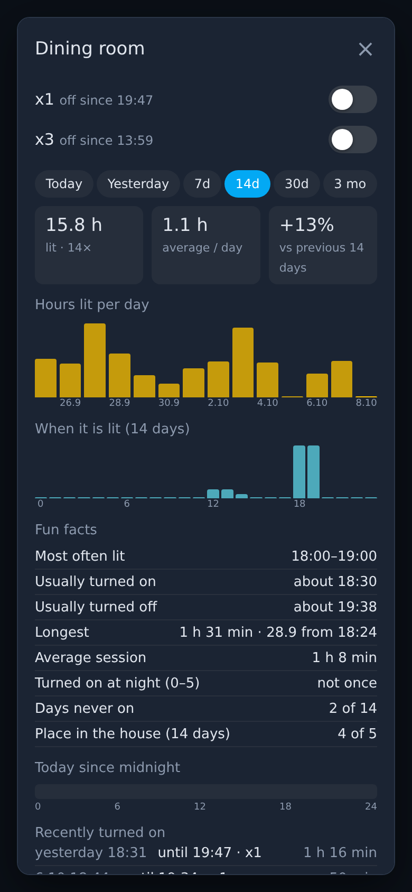
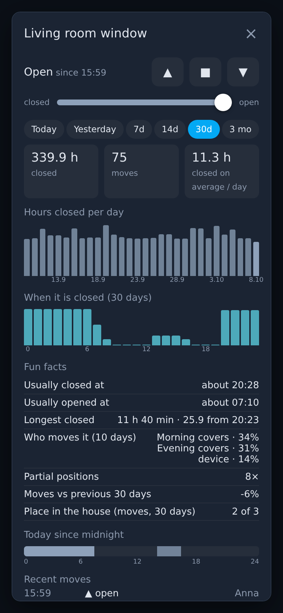
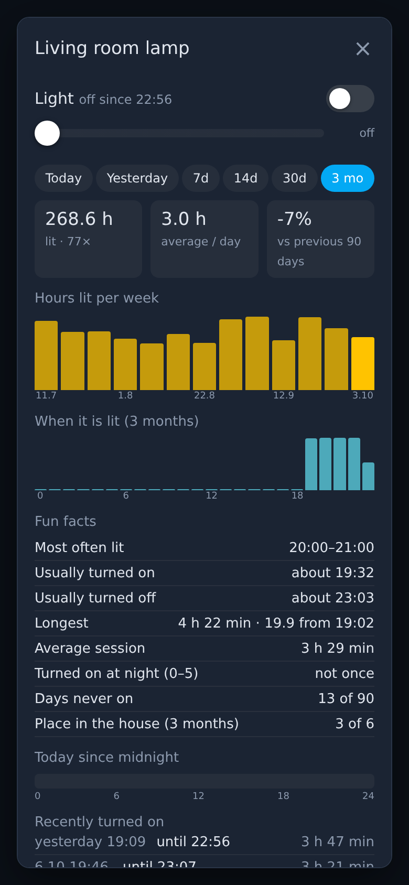

# Entity Insights

[![hacs][hacs-badge]][hacs] [![Validate][validate-badge]][validate] [![Buy Me a Coffee][bmc-badge]][bmc]

A **history dialog** for lights, switches and covers that opens from **any
card** — a tile, a button, a floor plan — or **instead of the entity
dialog**. Not a card: a module that adds the dialog to your dashboards.

- **how long it was on** (or a cover closed), how many times, average per
  day, and the change against the previous period
- **bars per hour, day or week**, and **at what hours of the day** it is on
- **fun facts**: usually turned on / off at, the longest session, nights,
  days never on, **place in the house** among the other lights or covers
- **who moves a cover**: an automation (by name), a person in the app,
  Google Assistant, or the device itself (a wall button)
- **today, yesterday, 7, 14, 30 days, 3 months** — the longer ranges from
  InfluxDB through [InfluxDB Proxy][proxy], when it is installed
- the controls on top: switches (several circuits of one lamp side by
  side), cover up / stop / down and a position slider
- numeric sensors: a chart through [Long-term Chart Card][chart]
- follows your Home Assistant language (English, Polish) and theme; made
  for a phone first

**See your home's habits** — when the lights go on, how long the covers
stay closed, who moves them — without building a single chart.

<p>
  
  
  
</p>

<sub>Screenshots from the browser test: a made-up home with generated history.</sub>

## Requirements

- Home Assistant 2024.12 or newer, with the recorder (default) and the
  logbook
- optional: [InfluxDB Proxy][proxy] **1.1.0 or newer** — ranges longer
  than the recorder keeps (30 days, 3 months)
- optional: [Long-term Chart Card][chart] — the chart for numeric sensors

## Installation

### HACS (recommended)

Entity Insights is in the HACS default store:

1. Open **HACS**, search for **Entity Insights** and download it — or click
   the button to open it in HACS directly:

   [![Open your Home Assistant instance and open this repository inside HACS.][hacs-open-badge]][hacs-open]

2. Refresh the browser (the resource is added by HACS)

Not found? Your HACS may not have refreshed its list yet: add it as a custom
repository instead — HACS → ⋮ → **Custom repositories** →
`https://github.com/stryczekk/entity-insights`, category **Dashboard**.

### Manual

Copy `entity-insights.js` to `config/www/`, then add a resource
(**Settings → Dashboards → ⋮ → Resources**): URL
`/local/entity-insights.js`, type **JavaScript module**.

## Use

### From any card — `fire-dom-event`

Any card that supports actions can open the dialog:

```yaml
type: tile
entity: light.kitchen
hold_action:
  action: fire-dom-event
  entity_insights:
    entity: light.kitchen
```

A lamp with two circuits, one dialog:

```yaml
hold_action:
  action: fire-dom-event
  entity_insights:
    name: Living room chandelier
    entities: [light.chandelier_small, light.chandelier_big]
    labels: [x1, x3]
```

| Option | Description |
|---|---|
| `entity` / `entities` | the entity, or several shown as one (any of them on = on) |
| `name` | dialog title (default: the friendly name) |
| `kind` | `onoff`, `cover` or `chart` — normally detected from the entity |
| `labels` | names of the switches, one per entity |
| `rank` | `true` / `false` — the "place in the house" fact (default: lights and covers) |
| `rank_with` | the entities to rank against (default: all of the domain, without groups and hidden ones) |
| `chart` | for sensors: options passed to Long-term Chart Card (without it installed, sensors open Home Assistant's own dialog) |

### Instead of the entity dialog

Put the invisible card on a dashboard; while that dashboard is open, the
entity dialog of the listed domains is replaced by this one (a button in
the dialog still opens Home Assistant's own):

```yaml
type: custom:entity-insights
more_info: [light, cover]
recorder_days: 10    # your recorder purge_keep_days (default 10)
```

### From your own card

```js
window.entityInsights.open({ entity: "cover.bedroom" }, this.hass);
window.entityInsights.openCustom("My dialog", (body, hass) => { /* draw */ });
```

## Where the history comes from

| Range | Source |
|---|---|
| up to `recorder_days` | Home Assistant recorder |
| longer | InfluxDB through [InfluxDB Proxy][proxy] (shown only when installed) |

"Who moved it" comes from the logbook, so it covers the recorder's days.
The comparison with the previous period is shown only when that period
has data.

## Tests

| Suite | What it covers | Needs |
|---|---|---|
| `tests/helpers.test.js` | ranges, periods, buckets, cover moves, ranking, request parsing, plurals | Node 20+ (`npm test`) |
| `tests/browser/run.sh` | the dialog in headless Chromium with a made-up home (100 days of generated history): lights, two circuits, brightness, switch, cover controls, who moves it, InfluxDB ranges, English and Polish, phone width, escaping of names, the entity dialog takeover, `fire-dom-event`, `openCustom` — service calls are recorded, nothing is switched | Chromium, Python 3 (`--shots` writes the screenshots above) |

## Support

Everything here is free and will stay free. If it saved you an evening of
tinkering, you can [buy me a coffee][bmc] ☕ — thank you!

## License

MIT

[proxy]: https://github.com/stryczekk/ha-influx-proxy
[chart]: https://github.com/stryczekk/long-term-chart-card
[hacs-open]: https://my.home-assistant.io/redirect/hacs_repository/?owner=stryczekk&repository=entity-insights&category=plugin
[hacs-open-badge]: https://my.home-assistant.io/badges/hacs_repository.svg
[hacs]: https://hacs.xyz
[hacs-badge]: https://img.shields.io/badge/HACS-Default-41BDF5.svg
[validate]: https://github.com/stryczekk/entity-insights/actions/workflows/validate.yml
[validate-badge]: https://github.com/stryczekk/entity-insights/actions/workflows/validate.yml/badge.svg
[bmc]: https://buymeacoffee.com/stryczekk
[bmc-badge]: https://img.shields.io/badge/Buy%20Me%20a%20Coffee-support-FFDD00?logo=buymeacoffee&logoColor=black
